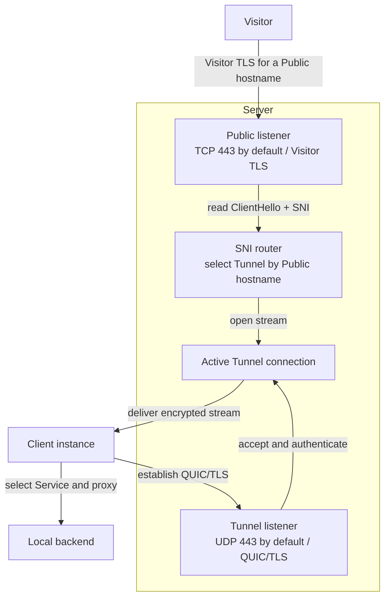

# Architecture

Runewarp keeps public ingress simple: the server routes encrypted traffic to a client, and the backend still terminates TLS unless a service opts into client-side termination.

## Summary

| Concern | Runewarp design |
| --- | --- |
| Public traffic | TLS passthrough by default; the public edge does not terminate customer TLS |
| Visitor addresses | Direct sockets or trusted PROXY v2 ingress become one canonical TCP tuple carried on every Tunnel stream |
| Routing authority | The **Server** selects the **Tunnel** from the current **Authorization snapshot** |
| **Client instance behavior** | The **Client instance** selects a **Service** locally and either forwards TLS bytes to a TLS-terminating **Local backend** (**TLS passthrough**) or terminates TLS itself before proxying plaintext to the **Local backend** (**Terminate mode**) |
| Tunnel transport | One long-lived HTTP/3 over QUIC/TLS **Tunnel connection** per effective **Server address** |
| Trust model | Server certificate validation plus pinned **Client identity** authentication |
| Process lifecycle | Separate Client and Server role runtimes own preparation, static/Managed construction, ACME, shutdown, fatal propagation, and teardown |

## Roles

| Component | Responsibility |
| --- | --- |
| **Visitor** | Connects to a **Public hostname** over TLS |
| **Server** | Accepts Visitor traffic, extracts SNI, selects a **Tunnel**, and forwards the original encrypted stream |
| **Client instance** | Maintains one or more **Tunnel connections**, selects a **Service**, and forwards traffic to a **Local backend** |
| **Local backend** | Terminates TLS under **TLS passthrough** or receives plaintext in **Terminate mode** and serves the operator application |

Server ingress and backend emission are independent. An opted-in Service receives a regenerated PROXY v2 header before TLS bytes in passthrough mode or before plaintext in Terminate mode. Other Services receive no header.

## Config handling

Runewarp prepares config in three steps:

1. Select the active config input, apply CLI overrides where allowed, and resolve defaults and config-relative paths.
2. Validate routing, trust, and mutual-exclusion rules against the prepared config.
3. Perform startup side effects only after validation succeeds.

Runtime commands request a full prepared-and-validated **Server** or **Client** config from Config preparation. Material-management commands request command-specific outcomes from the same seam (material directories, Server hostname, terminating Public hostnames, managed-mode detection) without reopening raw config sections or coordinating parsing helpers themselves.

This keeps config discovery and defaulting predictable without mixing them into startup side effects.

After Config preparation, the binary is only a process adapter: it translates CLI input and operating-system signals, then crosses one `ClientRuntime` or `ServerRuntime` library seam. The separate role runtimes own startup side effects, static-versus-Managed construction, optional ACME work, child-runtime completion, orderly shutdown, and teardown. Client and Server deliberately do not share a generic runtime framework because their drain and Managed-session lifetimes differ. The crate-root `ClientRuntime` and `ServerRuntime` exports are the supported process-integration surface. CLI-only lifecycle mechanics stay private. The remaining crate-root startup, transport, and controller exports are intentional lower-level library and integration-test surfaces; they do not participate in process orchestration.

## Hostname domain values

Runewarp turns hostname input into opaque canonical domain values at the first validation seam:

- `server.hostname`, the host portion of `client.server-address`, and the host portion of each `client.server-addresses[]` entry become **Server hostname** values
- `server.tunnels[].public-hostnames`, `client.services[].public-hostnames`, and parsed ClientHello SNI become **Public hostname** values
- lowercase normalization and trailing-dot stripping happen before duplicate detection and route lookup

After a hostname crosses that seam, routing and service-selection code carries the typed value instead of raw strings. That keeps normalization, equality, and hashing rules in one place while preserving the domain distinction between the public routed hostname and the Runewarp edge hostname.

## End-to-end flow

In passthrough mode, the forwarded byte stream stays encrypted until the local backend terminates TLS. In terminate mode, the client terminates TLS and proxies plaintext TCP to the backend.

## Routing model

Runewarp keeps public routing authority on the server:

- every static Server `[[server.tunnels]]` entry lists explicit **Public hostnames**; Managed mode receives the same authorization from Control
- the Server routes only those hostnames into a **Tunnel**
- the Client does not register hostnames with the Server
- hostname overlap is rejected within Server **Tunnels** and within Client **Services**

That keeps public hostname ownership explicit even when the client uses a different local routing shape.

## Supported routing shapes

| Shape | Server side | Client side | Use when |
| --- | --- | --- | --- |
| **Hostname mirroring** | Explicit **Public hostnames** on each **Tunnel** | Explicit **Public hostnames** on each **Service** | The Client needs per-host local routing decisions |
| **Client with a Catch-all Service** | Explicit **Public hostnames** on each **Tunnel** | One sole **Service** with no `public-hostnames` | One backend should receive every hostname the Server already authorized for that Tunnel |

Both shapes still use **Server-authoritative routing** for public ingress.

## Data path

### Passthrough (default)

1. A **Visitor** connects to the **Server** on its configured public TCP listener, `server.public-bind-address`, which defaults to `0.0.0.0:443`.
2. One Server Visitor-intake module owns global admission, trusted direct-or-strict-PROXY tuple resolution, canonical-source admission, the shared intake deadline, ClientHello parsing, permit release, shutdown cancellation, and rejection/recovery reporting.
3. The Server buffers enough of the ClientHello to extract SNI.
4. The Server rejects non-TLS traffic, missing-SNI traffic, and non-ACME application traffic addressed to the **Server hostname**.
5. The Server selects a **Tunnel** by exact **Public hostname**.
6. If that Tunnel has no active **Tunnel connection**, the Server drops the connection.
7. Otherwise, one Tunnel-framing module writes the canonical Visitor tuple followed by the original encrypted bytes over the selected Tunnel connection.
8. The receiving **Client instance** crosses the same framing seam to validate and consume the tuple before re-reading the forwarded ClientHello, selecting a **Service**, and connecting to the **Local backend**.
9. If no Client Service matches, the Client rejects the stream.
10. The Local backend terminates TLS and serves the application.

### Terminate (opt-in per Service)

Steps 1–9 are the same. In step 8, when the matched Service has `tls-mode = "terminate"`:

8a. The Client completes the TLS handshake with the Visitor using the per-hostname leaf certificate — from `client.public-cert-dir` (manual path) or from `[client.acme]` (ACME path). In Client ACME mode the **Client instance** owns one live ACME manager per terminating **Public hostname** for the process lifetime, shared across independent Server-address workers and Tunnel-connection reconnects, and does not block startup on certificate readiness; a hostname without a ready certificate fails closed at the TLS handshake with no fallback to passthrough.
8b. The Client connects to the Local backend in plaintext TCP.
8c. The Client proxies decrypted data between the TLS stream and the plaintext backend connection.

The Local backend receives unencrypted bytes directly and does not need to terminate TLS.

The Tunnel-framing module owns the internal PROXY v2 envelope carried in each WebTransport Visitor stream on both ends. **Backend PROXY emission** remains a distinct per-Service seam and only reuses the PROXY v2 codec internally.

Every Tunnel connection uses ordinary HTTP/3 with ALPN `h3`, required pinned-identity mTLS, and no application 0-RTT. The Client waits for a valid `GET /v1/tunnel/events` snapshot, establishes one WebTransport draft07 session on `/v1/tunnel/session`, then reserves up to 256 idle Visitor credits backed by permits. The Server opens one WebTransport bidirectional stream per Visitor without a per-Visitor acceptance exchange. Idle credits and active streams share a Client-instance budget, configured by `client.max-visitor-streams` with a 16,384 default across all connections; one connection can carry up to that budget. A quiet connection can retain 256 permits. GOAWAY preserves those reservations for committed streams still in transit. On WebTransport DRAIN, the Client cancels pending acquisition, stops refill and releases idle permits before connection close, while active and application-queued Visitors retain their leases. Runewarp sends no datagrams. The event stream carries the Server runtime generation and an optional replacement hint, with no configuration. Every Tunnel connection on one Server runtime follows one shared snapshot source; Managed mode publishes hints from the Server input. Static and Managed modes, manual certificates, and ACME use this same transport.

The HTTP/3 module uses `h3`, `h3-quinn`, `h3-webtransport` and its transitive `h3-datagram` dependency from the layered [`runewarp/h3` fork](https://github.com/runewarp/h3), all pinned to integration commit `df27106fb243baaf867d11441d11cf671ec9da7e` under [#253](https://github.com/runewarp/runewarp/issues/253). No h3 source is vendored. Runewarp directly depends on `h3-webtransport` for WebTransport session and driver ownership; it uses no datagram API. The session carries Visitor bytes as raw bidirectional streams. Both peers advertise a 16 KiB decoded-header limit and use a 64 MiB connection receive window with a 1,250,000-byte stream receive window. The Server driver resolves request headers concurrently before spawning handlers, rejecting oversized headers without closing the connection. These transport and decoded-header bounds do not cap h3's encoded-frame accumulation; see [security](security.md#tunnel-http3-boundary).

Server graceful shutdown sends GOAWAY concurrently on all connections, seals new Visitor opens, and lets placed streams finish within the configured deadline. FIN maps to half-close; errors and aborted writes reset streams. No peer depends on received cancellation codes. Both peers require the WebTransport Visitor carrier; older receive-slot binaries cannot carry Visitors with this version. Operators must upgrade Clients and Servers together. Old `runewarp/1` binaries remain incompatible.

The `tunnel` module owns the fork's detached drivers. On the Server, `h3_webtransport::server::new` separates the connection driver from its cloneable WebTransport admission handle. One owned driver task polls ordinary request intake, resolves headers concurrently under deadlines, reaps request handlers, evicts incomplete classifiers every signaling-deadline interval and during shutdown, and owns their cancellation on teardown. A request handler admits the WebTransport session alongside event requests, then retains the accepted WebTransport session and observes its CONNECT lifecycle until the connection ends.

On the Client, a separate extension driver runs while the event gate and WebTransport session CONNECT complete. Owned tasks then follow events and jointly accept Visitors, replenish permit-backed credit and observe the WebTransport session. Both peers close the entire Tunnel connection with `H3_NO_ERROR` on WebTransport session termination; the existing address worker owns reconnect. Server graceful drain counts ordinary signaling, pending Visitor opens and active Visitor streams. After that local work ends, it sends the standard WebTransport DRAIN capsule and retains the session until the Client releases its remaining Visitor leases and sends CLOSE. A locally enqueued FIN alone cannot prove that the Client consumed the tail. Both phases share the original graceful deadline. GOAWAY and DRAIN leave the WebTransport session alive; revocation and deadline expiry still close the whole connection immediately.

Graceful Client shutdown runs the other direction. The Address controller shares one Client-instance shutdown mode and deadline with every address worker. Each connection's run withdraws its connection with an ordinary signaling request while still accepting Visitors the Server committed first. The Server serializes withdrawal with Visitor stream commitment, counts pending opens and active Visitor streams for quiescence, answers `204` once they end, and owns a fixed post-quiescence close. A withdrawal protocol failure becomes an address-worker failure, so the controller preserves the first one as the process error without escalating the other drains.

A replacement hint moves an address to another Server runtime without migrating streams. The address worker keeps at most one candidate Tunnel connection beside the primary. The candidate binds a fresh endpoint and runs the production attempt, but the Tunnel client checks the first snapshot against the hinted generation before the WebTransport session, so a candidate that reached the wrong runtime closes before it holds credit. A validated candidate offers credit only once the worker starts its run, so one dropped at join time never holds a Visitor. It then joins as a second active connection. Nothing withdraws the old one: it leaves when its runtime drains it with GOAWAY or the connection is lost, and the joined connection takes over as primary without a reconnect. The primary's hint watch pauses on subscription failure and stops on GOAWAY, so the worker needs no event-stream knowledge. Assignment convergence and Client readiness stay per address and ignore candidates. [`protocol.md`](protocol.md#candidate-tunnel-connections) owns the full lifecycle.

The credit controller serializes the target update `held → 0 → held` under its state mutex and restores the configured limit to active plus idle permits before returning. The temporary lower target forces Quinn's batched MAX_STREAMS advertisement without granting a target above held permits. Quinn's own locks are separate for each call, so transport completions can interleave. Previously sent credit is irrevocable; the Client tries the budget once on an arrival without idle credit, then resets and stops it before handler work if exhausted. At budget exhaustion, a replacement can reach this guard while the previous handler still retains a finished stream, including under production scheduling. The two stream halves retain the permit until both transport handles drop, lowering the target before the final half releases its handles. [ADR 0007](adr/0007-webtransport-visitor-streams.md) records the API dependency and interleaving argument.

At stream-budget saturation, completing or aborting one Visitor may leave replacement credit unadvertised even after its permit becomes available. A waiting Visitor can reach the Server's five-second open deadline and lose its connection while existing Visitors can continue forwarding. Single-release recovery is a known early-alpha availability limitation tracked in [#267](https://github.com/runewarp/runewarp/issues/267). The held/zero/held workaround and no-wait admission guard remain; no transport fix or reliable single-release recovery is claimed.

Client fork intake, pending-prefix and per-session delivery queues each admit 256 streams. Its application handoff owns permits, so it cannot accumulate more Visitors than the aggregate budget. Signaling has eight request streams independent of Server-opened Visitor credit. There are no idle Visitor CONNECT requests or slot queues. Server admission allows 4,096 pending opens and 65,536 active routed streams before Unix fd sizing; opens wait for credit under the existing five-second deadline without retrying another pool member.

## Trust model

| Trust boundary | Design |
| --- | --- |
| **Server hostname** | Identifies the public Runewarp edge, not the operator application |
| **Server certificate** | Protects the tunnel endpoint and is validated by the Client |
| **Server CA** | Optional private trust anchor for the manual Server-certificate path |
| **Client identity** | Pinned public-key identity used to authenticate the Client to the Server; each Tunnel may authorize one or more of them |
| **Public hostname authorization** | Owned by the current **Authorization snapshot**: static `server.tunnels[].public-hostnames` at startup, or Control-published Server snapshots in **Managed mode** |
| **Authorization snapshot** | Immutable Server-owned set of Public-hostname routing and trusted Client identities; Public-hostname routing and QUIC Client-identity handshake admission consult the same current snapshot. Static snapshots have no Tunnel ID; managed snapshots carry Tunnel IDs as pool continuity keys |
| **Managed session** | Authenticated Control relationship for versioned full-input snapshots and applied-state acknowledgments carrying the revision (plus the Server runtime generation on Servers); separate from **Server readiness**, Visitor traffic, and **Tunnel connections** (see [`managed.md`](managed.md)) |
| **Public hostname CA** (manual) | Private trust anchor in `client.public-cert-dir` shared with Visitors when `tls-mode = "terminate"` is in use |
| **Public hostname certificates via Client ACME** | Automatically provisioned by Let's Encrypt via `[client.acme]` for **Public hostnames** of terminating Services; `acme-tls/1` challenge traffic for those hostnames is routed through the Server to the Client like ordinary Visitor TLS |

The Client validates the Server certificate through typed system trust or an exclusive CA bundle. Exclusive-CA attempts do not load or combine system roots. The Server authenticates a pinned **Client identity** from the Client public key rather than the certificate lifetime.

In **Static mode**, the Server loads one startup-only **Authorization snapshot** and the Client starts one address worker per configured **Server address**. In **Managed mode**, Control replaces the same complete authorization or assignment inputs. Server replacement commits routing and handshake admission together and preserves Tunnel-pool continuity by **Tunnel ID**; Client replacement adds, Retires, or re-adopts address workers without duplicate dialing.

Static and Managed Client address workers cross the same production Tunnel-connection-attempt module. That module owns ordered DNS selection, per-attempt trust and Client-identity reload, QUIC and HTTP/3 establishment, the event-stream gate and WebTransport session CONNECT, typed attempt and connection-end classification, and lifecycle reporting context. DNS is its only internal seam: the runtime uses the system resolver and deterministic tests use scripted results. The Address worker remains the sole owner of retry jitter, delay reporting, waiting, and reset.

Each Managed runtime maintains one mutually authenticated HTTP/2 **Managed session**. The full apply, readiness, convergence, Retiring, Control-loss, and drain contract is in [`managed.md`](managed.md).

## Operational boundaries

- Visitor intake, QUIC handshakes, stream opening, active streams, and Client stream handlers are bounded; overload rejects the newest work
- each effective **Server address** has an independent connection and retry lifecycle, so one failure does not tear down healthy connections to other addresses
- a **Tunnel** remains available while one authenticated **Tunnel connection** is live; pooled connections use least-active placement with round-robin tie-breaking
- a placed stream stays on its selected **Tunnel connection** and is never migrated
- Static and Managed modes are mutually exclusive startup shapes; switching requires configuration replacement and process restart
- Static Clients emit a one-shot **Client readiness** signal; Managed Clients report **Assignment convergence** instead
- optional **Server readiness** reports ingress admission only, not Tunnel coverage or application health
- orderly shutdown stops new work before closing all active **Tunnel connections**; graceful shutdown offers a bounded opportunity for completion without guaranteeing it, while fast shutdown skips that longer window
- TLS passthrough remains the default; plain HTTP backends require Terminate mode

[`protocol.md`](protocol.md) is canonical for exact wire ordering, limits, deadlines, retry, placement, and shutdown behavior. [`managed.md`](managed.md) owns Managed-session limits and reconciliation behavior.

## Capacity and process resources

Both static and Managed Client runtimes prepare one shared effective Visitor budget before address workers start. Unix startup attempts to raise the soft fd limit to hard through `rlimit`, respecting macOS's kernel ceiling, then clamps Visitor capacities when necessary. It reserves 512 descriptors plus Client endpoint headroom. One active Visitor normally owns one backend TCP socket on the Client. On the Server, pre-routing intake, pending stream opens and active routed proxies each own separate Visitor TCP sockets; sizing includes all three, despite intake permits being released before stream opening. Server clamping distributes the available descriptors proportionally across those stages without raising any fixed maximum. See [configuration](configuration.md#file-descriptor-capacity) for exact arithmetic, low-limit behavior and operator guidance.

The [capacity benchmark](research/visitor-capacity-benchmark.md) uses real role runtimes and counts working Visitors. The 64 MiB connection and 1,250,000-byte stream receive windows bound unread transport bytes, not whole-process memory. Per-Visitor proxy buffers, task and stream state, TLS and TCP buffers add costs. Shared receive credit can be retained by slow readers and stall unrelated Visitors or signaling. A larger Visitor budget increases possible resource use; neither fd sizing nor finite QUIC windows provide per-stream fairness or a process RSS cap.

Historical burst-load connection losses remain unexplained and deferred under [#268](https://github.com/runewarp/runewarp/issues/268). The recorded successful runs do not establish high-load reliability, and further stress and performance work is outside the current alpha scope.
